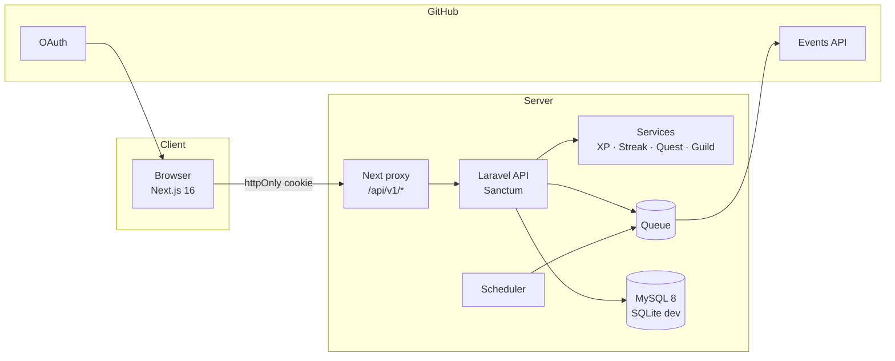
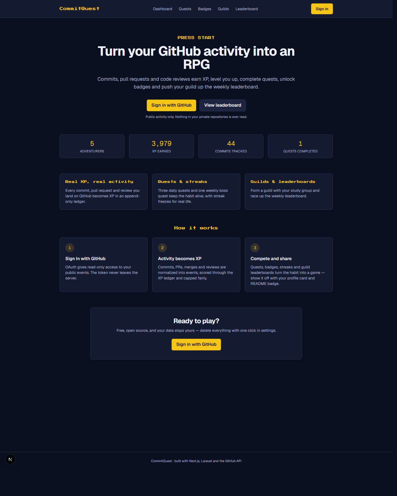
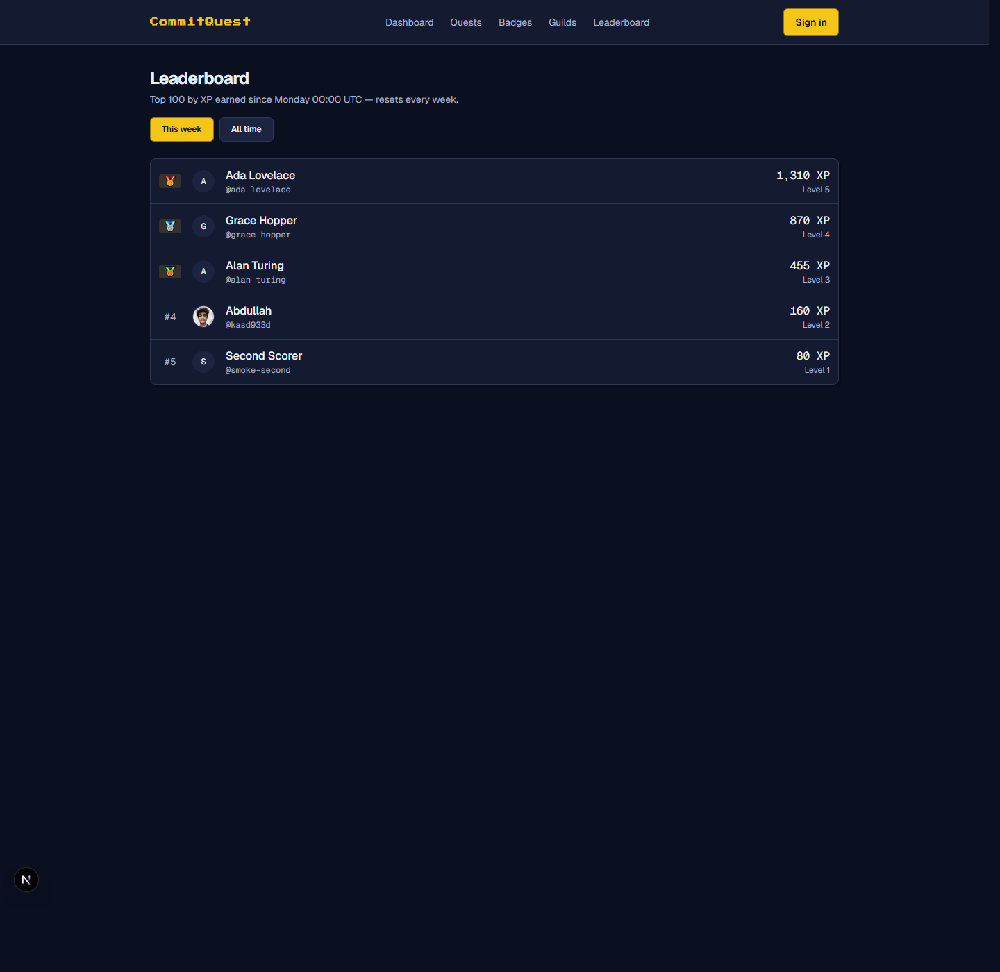
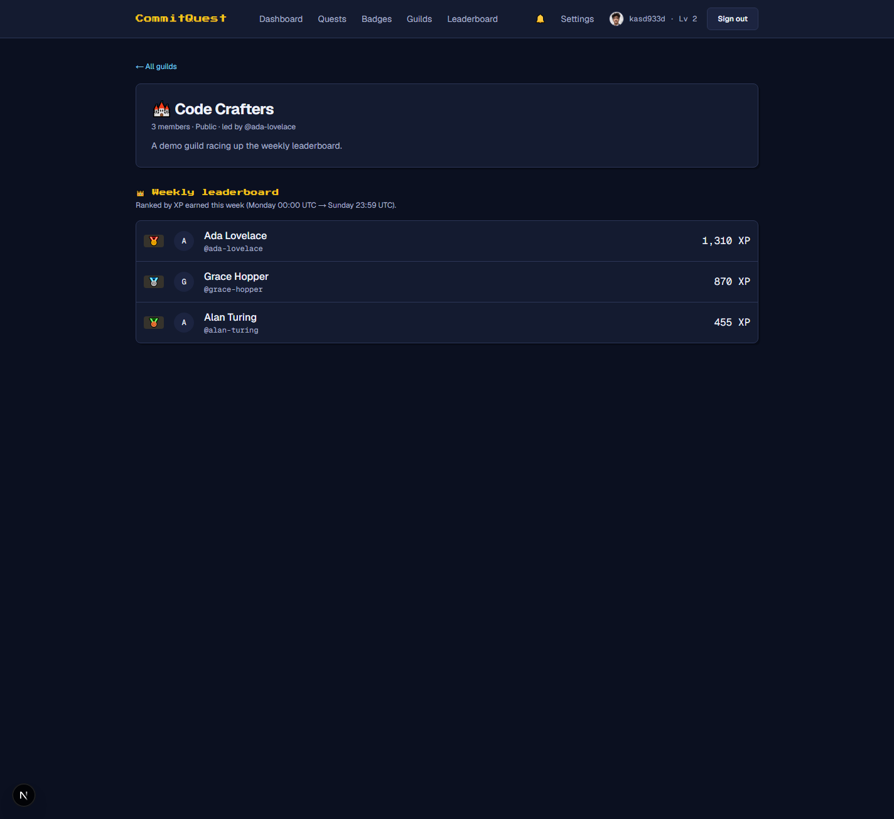
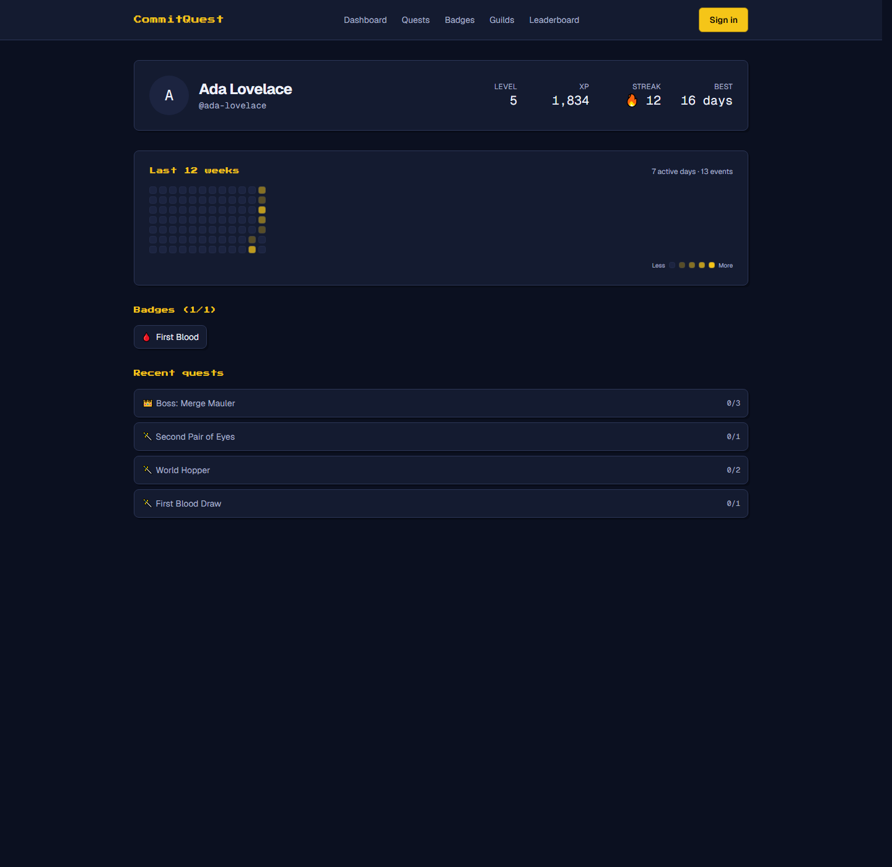
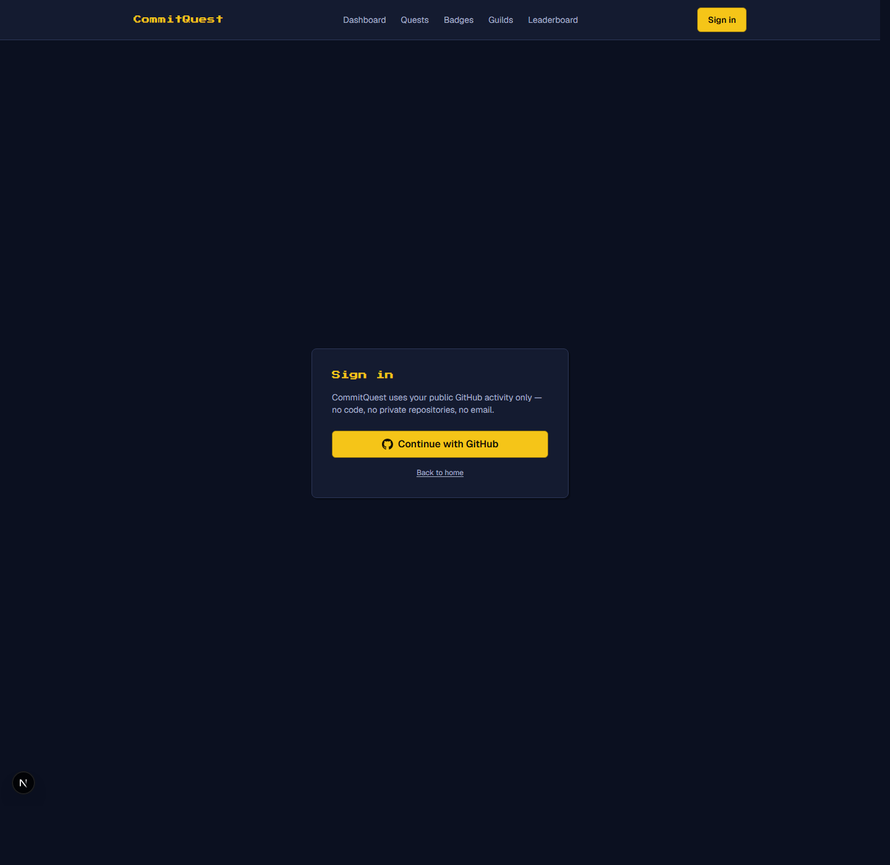

# CommitQuest

> Turn your real GitHub activity into an RPG. Commits, pull requests and code reviews earn XP, level you up,
> complete quests, unlock badges and push your guild up the weekly leaderboard.

Full-stack portfolio project: **Next.js (TypeScript, Tailwind)** web app + **Laravel (PHP 8.3)** JSON API + **MySQL 8**,
with GitHub OAuth and the GitHub Events API.

- Product requirements: [`CommitQuest_PRD.md`](./CommitQuest_PRD.md)
- Engineering decisions: [`docs/decisions.md`](./docs/decisions.md)

## Repository layout

```
commitquest/
├── apps/
│   ├── web/          # Next.js 16 (App Router, TypeScript, Tailwind 4)
│   └── api/          # Laravel 12 JSON API (Sanctum, Socialite, queues, scheduler)
├── docker-compose.yml
├── .github/workflows/ci.yml
└── docs/
```

## How it works

CommitQuest turns public GitHub activity into game progress:

1. **Sign in with GitHub.** The OAuth flow is state-validated and exchanged
   server-side; only then does a Sanctum token land in an httpOnly cookie —
   the GitHub token itself never reaches the browser.
2. **Activity becomes XP.** A scheduled job polls the GitHub Events API
   (ETag-cached, sha-deduplicated), normalizes events (including commit ranges
   via the Compare API) into `activity_events`, and an append-only
   `xp_ledger` scores them with fair daily caps. XP is recomputed from
   scratch on every sync, so replays and corrections stay consistent.
3. **The RPG layer.** Timezone-aware streaks (with freezes), 3 daily quests +
   1 weekly boss quest, 12 unlockable badges and notifications keep the habit
   going — all rules live in `app/Services` and are unit tested.
4. **Compete and share.** Weekly and all-time leaderboards, guilds with their
   own weekly board, a public profile page with an OG image, and a embeddable
   README badge SVG.



## Screenshots

| Landing | Leaderboard |
|---|---|
|  |  |

| Guild weekly board | Public profile | Quests |
|---|---|---|
|  |  |  |

Badge in a README (rendered by the `/api/badge/{username}.svg` route — the URL
becomes public once the app is deployed):

```md
[](https://YOUR-DEPLOY/u/your-username)
```

## Quick start

### Prerequisites

- Node 20+ and npm
- PHP 8.3+ with `pdo_mysql`, `pdo_sqlite`, `mbstring`, `curl`, `dom`, `xml`, `zip`
- Composer 2
- Docker (optional — only needed to run MySQL / the containerised stack)

### 1. API

```bash
cd apps/api
composer install
cp .env.example .env          # then fill in the GitHub OAuth credentials
php artisan key:generate
touch database/database.sqlite # local SQLite dev database (see docs/decisions.md)
php artisan migrate --seed
php artisan serve             # http://localhost:8000
```

#### GitHub OAuth app

Create an OAuth app under **Settings → Developer settings → OAuth Apps → New
OAuth App** and use exactly:

- Homepage URL: `http://localhost:3000`
- Authorization callback URL: `http://localhost:3000/auth/callback`

Paste the Client ID and Client Secret into `apps/api/.env`
(`GITHUB_CLIENT_ID`, `GITHUB_CLIENT_SECRET`). GitHub must come back to Next's
`/auth/callback` — that route exchanges the code server-side and only then puts
the token in an httpOnly cookie, so the token never appears in the browser.

Queue worker and scheduler (two extra terminals):

```bash
php artisan queue:work
php artisan schedule:run      # wire up a cron/Task Scheduler entry for every minute
```

### 2. Web

```bash
cd apps/web
npm install
cp .env.example .env.local
npm run dev                   # http://localhost:3000
```

### 3. Docker (optional)

```bash
docker compose up --build     # web :3000, api :8000, mysql :3306 (+ queue & scheduler)
```

## Tests and checks

```bash
cd apps/api
composer test         # PHPUnit/Pest suite (unit + feature)
vendor/bin/pint       # code style

cd apps/web
npm run lint
npm run typecheck
npm run test:unit
npm run build
```

CI (`.github/workflows/ci.yml`) runs lint, type check, backend tests and both builds on every push and PR.

## Changelog

| Milestone | Status | Summary |
|---|---|---|
| M0 — Setup | ✅ done | Monorepo, Laravel 12 + Next.js 16 scaffolds, Docker Compose, CI (lint, typecheck, tests, build) |
| M1 — Auth | ✅ done | GitHub OAuth (state-validated), Sanctum token in httpOnly cookie, proxy, `/me`, protected dashboard |
| M2 — Ingestion & XP | ✅ done | GitHub Events sync (ETag, backoff), normalizer (commit ranges via the Compare API, sha-level dedupe), `activity_events`, `XpService` + ledger, 10 commits/repo/day & 300 XP/day caps, `xp:rebuild`, activity feed + "Sync now" |
| M3 — Streaks, quests, badges | ✅ done | `StreakService` (timezone-aware days, freezes 1/7-day milestone max 2, 12-week heatmap), `QuestService` (3 daily + 1 weekly boss, auto progress + auto-claimed rewards), 12 badges, notifications (level up, quest, badge, streak-at-risk), `/quests` + `/badges` pages, notification bell |
| M4 — Social | ✅ done | Public profiles `/u/[username]` (heatmap, badges, recent quests), dynamic OG image, README badge SVG (`/api/badge/{username}.svg`, 10-min cache), global leaderboard (weekly + all-time top 100), guilds (max 3/user, max 50 members, invite codes, weekly guild leaderboard), settings (timezone, visibility, badge snippet, account deletion) |
| M5 — Polish & launch | 🚧 code done, deploy pending | Landing page with live `/stats` counters + "How it works", demo seeder (3 users, 1 guild), security headers (nosniff, frame-deny, referrer/permissions policy, CSP for the badge SVG), a11y pass (skip link, reduced-motion), API 401 hardening (no more 500 on unauthenticated browser hits), README screenshots + architecture diagram — **public deploy awaiting hosting choice** |
